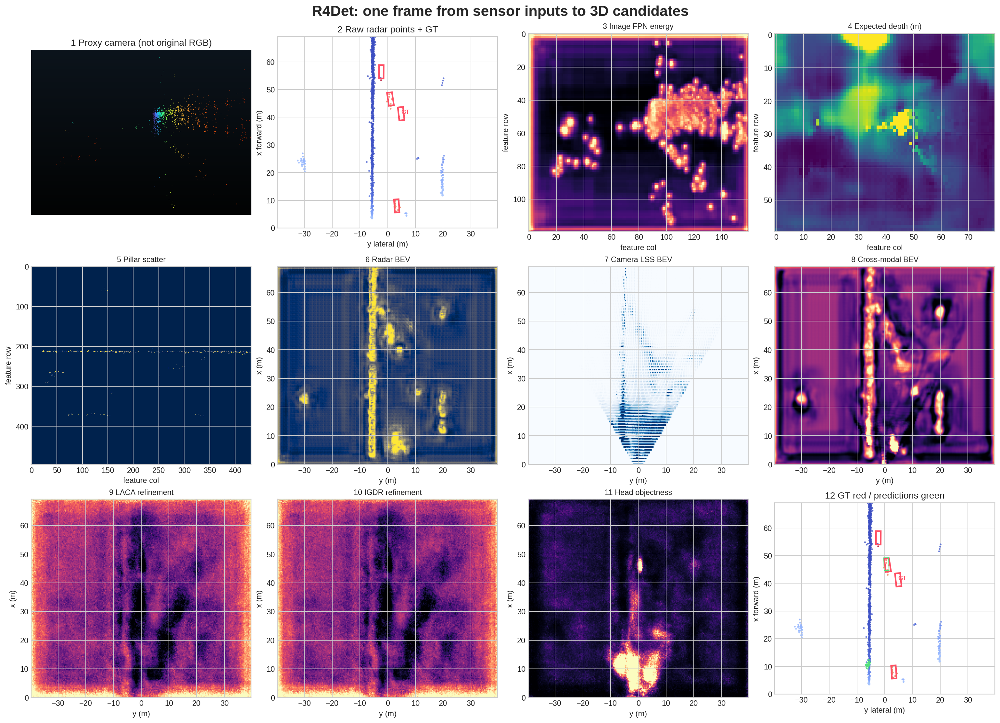

# R4Det 单帧流程详解：从传感器输入到 3D 候选框

本文以 `code_walkthrough/figures/02_frame_070070_process.png` 为主线，从深度学习基础开始解释 R4Det 的单帧处理过程。目标是明确每个编号阶段的真实输入、模型计算、真实输出，以及图中热力图是怎样从张量生成的。



## 0. 阅读前提

### 0.1 正常输入与本地公开演示的区别

R4Det 正常的相机分支输入是车辆相机拍摄的真实道路图像：

```text
真实相机图像
→ 图像预处理
→ ResNet-50
→ FPN
→ 深度估计
→ Camera BEV
```

当前本地 `070070` 公开演示缺少同步原始相机图片。这是数据资产缺失，不是模型代码缺失。为了让完整前向流程能够实际运行，`tools/prepare_r4det_public_smoke.py` 使用标定矩阵把真实雷达点投影到相机平面，并生成了一张三通道代理图片。

模型不会主动区分真实图片和代理图片：二者都会作为三通道图像进入同一套 ResNet-50 和 FPN。本文解释模型原理时按照正常的真实相机图片说明；涉及 `070070` 实测图时，会明确指出代理输入带来的限制。

### 0.2 整张图的处理路线

```text
图像路线：
1 相机图像 → 3 ResNet-50/FPN → 4 深度估计 → 7 Camera BEV

雷达路线：
2 原始雷达点 → 5 Pillar/Scatter → 6 Radar BEV

融合与检测路线：
6 Radar BEV + 7 Camera BEV
→ 8 跨模态融合
→ 9 LACA
→ 10 IGDR
→ 11 3D 检测头
→ 12 三维候选框
```

第 3 步的图像特征还会被第 9 步和二维实例分支使用；第 4 步的深度信息也会参与第 7、9、10 步。因此这不是一条只把上一张小图传给下一张小图的直线，而是一张存在多处分支和复用的数据流图。

### 0.3 张量形状怎样阅读

图像网络常用以下顺序表示张量：

```text
[B, C, H, W]
```

- `B`：batch size，一次处理的图片数量；
- `C`：channel，通道数量；
- `H`：height，高度；
- `W`：width，宽度。

例如：

```text
[1, 3, 480, 640]
```

表示一次处理 1 张图片，图片有 3 个颜色通道，高 480 像素、宽 640 像素。

## 1. Proxy camera / 正常真实相机输入

### 1.1 正常情况下输入什么

R4Det 正常读取车辆前置相机拍摄的道路图片。原始图片可能是：

```text
[960, 1280, 3]
```

数据管线依次执行图像读取、缩放或增强、归一化、补齐尺寸和张量转换。当前 TJ4D 配置最终使用 `480×640` 的图像，因此模型收到：

```text
[1, 3, 480, 640]
```

这里的 `1` 是一张图，`3` 是 BGR 三个颜色通道。

### 1.2 图像预处理做什么

配置使用以下 BGR 均值：

```text
[103.530, 116.280, 123.675]
```

标准差均为 1，并且 `to_rgb=False`，所以保持 Caffe 风格的 BGR 顺序。假设某个像素为：

```text
[B, G, R] = [120, 150, 200]
```

归一化后近似为：

```text
[120 - 103.530, 150 - 116.280, 200 - 123.675]
= [16.470, 33.720, 76.325]
```

随后维度从图片存储常见的 `[H,W,C]` 调整成 PyTorch 卷积使用的 `[B,C,H,W]`。

### 1.3 本地代理图是怎样产生的

本地演示读取 `070070` 帧的真实雷达点和标定矩阵。对每个三维点执行：

```text
雷达三维坐标 (x,y,z)
→ 雷达到相机的坐标变换
→ 相机内参投影
→ 图像像素坐标 (u,v)
```

准备脚本只保留深度在 1～80 m 之间、且投影落在画面内的点，然后按距离着色、按雷达强度确定圆点大小，画到暗色背景上。

这张代理图只用于检查：

- 图像读取和预处理是否正常；
- 标定投影是否正常；
- 图像骨干、深度网络和 Camera BEV 是否能运行；
- 雷达与图像分支是否能完成融合。

它缺少真实道路的纹理、轮廓和颜色信息，因此不能用于复现论文 AP。

### 1.4 第 1 步的输入与输出

正常情况：

```text
输入：真实相机文件 [H,W,3]
处理：读取、缩放/增强、归一化、调整维度
输出：[1,3,480,640]
去向：第 3 步 ResNet-50
```

## 2. Raw radar points + GT

### 2.1 图中显示什么

图中横轴 `y lateral (m)` 表示车辆左右方向，纵轴 `x forward (m)` 表示车辆前方距离。蓝色散点是真实雷达回波，红色旋转框是数据集给出的真值框 GT。

车辆自身大致位于：

```text
x = 0 m, y = 0 m
```

图上越高，表示目标或雷达点距离车辆越远。

### 2.2 原始数据与模型输入

`070070` 原始雷达文件形状为：

```text
[3159, 8]
```

表示 3159 个点，每个点有 8 个原始字段。当前配置选择其中五个字段：

```text
x, y, z, velocity, SNR
```

经过范围过滤后，模型使用的点集合可表示为：

```text
[
  [x1, y1, z1, velocity1, SNR1],
  [x2, y2, z2, velocity2, SNR2],
  ...
]
```

形状为 `[N,5]`，其中 `N` 会随不同帧变化。

### 2.3 为什么不能直接交给普通二维卷积

二维卷积要求输入位于规则网格上，而雷达点是稀疏且不规则的集合：

```text
点 1：(10.2,  1.3, 0.4)
点 2：(23.5, -4.7, 0.1)
点 3：( 8.1,  0.2, 0.7)
```

每帧点数也可能不同。因此雷达点需要在第 5 步经过 Pillar 编码和 Scatter，转换为规则二维特征网格。

### 2.4 GT 是否进入模型

红色 GT 框是正确答案，用于训练监督或评价。在当前推理可视化中，GT 只用于最后与预测框对照，不会作为检测答案送进模型。

### 2.5 第 2 步的输入与输出

```text
输入：原始雷达文件 [3159,8]
模型选择：x、y、z、velocity、SNR
输出：过滤后的雷达点 [N,5]
去向：第 5 步 Pillar 编码

附加信息：4 个 GT 三维框
用途：训练/评价和第 12 步可视化对照
```

## 3. Image FPN energy

这一阶段的实际模型路径为：

```text
图像 [1,3,480,640]
→ ResNet-50
→ FPN
→ 五张多尺度特征图
```

标题中的 `energy` 不是模型额外预测的目标概率，而是绘图脚本为了观察特征而计算的幅度摘要。

### 3.1 卷积在做什么

卷积使用一个可学习的小窗口查看当前位置及周围像素。用一个简化的单通道例子说明，局部图像为：

```text
0 0 0
0 8 0
0 0 0
```

假设卷积核为：

```text
-1 -1 -1
-1  8 -1
-1 -1 -1
```

对应位置相乘再求和会产生较大的输出，表示这个卷积核对“中心明显不同于周围”的结构有响应。

真实 ResNet 中有很多通过训练学习的卷积核。浅层主要响应局部明暗、边缘、方向和纹理；深层逐渐组合更大区域的结构和上下文。对于真实相机图像，它可以从道路、车辆轮廓、行人形状和场景关系中提取特征。

### 3.2 ResNet-50 的开头

输入为：

```text
[1,3,480,640]
```

先经过一个 `7×7`、步长为 2 的卷积：

```text
[1,64,240,320]
```

再经过最大池化：

```text
[1,64,120,160]
```

空间尺寸逐渐缩小有两个作用：减少计算量；让后层的一个特征格能够综合更大范围的输入像素。

### 3.3 ResNet-50 的 Bottleneck 残差块

一个 Bottleneck 的主要路径为：

```text
输入 x
 ├─────────────────────────────┐
 └→ 1×1 卷积 → 3×3 卷积 → 1×1 卷积
                               │
                     与捷径输入相加
                               ↓
                             ReLU
```

可概括为：

```text
y = F(x) + x
```

`F(x)` 是卷积学习的新信息，`x` 是直接保留下来的输入。当尺寸或通道数变化时，捷径分支也会用卷积调整形状后再相加。

R4Det 使用的 ResNet-50 有四组 Bottleneck，数量依次为：

```text
3、4、6、3
```

当前配置使用 `style='caffe'`，需要下采样时，将步长 2 放在 Bottleneck 的第一个 `1×1` 卷积中。

### 3.4 ResNet-50 的真实输出

本帧实际得到四个尺度：

```text
C2 [1,  256,120,160]
C3 [1,  512, 60, 80]
C4 [1, 1024, 30, 40]
C5 [1, 2048, 15, 20]
```

例如 `C2 [1,256,120,160]` 表示：每个 `120×160` 空间位置都有一个 256 维特征向量。

可以把 256 个通道想成 256 张叠放的响应图。但不应强行把某个通道命名为固定的“车通道”或“行人通道”；这些通道通常共同编码图像结构。

空间分辨率越高，位置越精细；空间分辨率越低，每个格子覆盖的原图范围越大、上下文越多。

### 3.5 FPN 为什么存在

真实道路中的目标尺度差异很大：近处车辆可能占据大量像素，远处行人可能只有很小一块区域。

ResNet 的浅层特征位置较精细，但高级上下文较少；深层特征上下文丰富，但位置较粗。FPN 将这两类信息结合起来。

### 3.6 FPN 先统一通道数

FPN 使用 `1×1` 卷积，把 C2～C5 全部变成 256 通道：

```text
C2： 256 → 256，尺寸 120×160
C3： 512 → 256，尺寸  60×80
C4：1024 → 256，尺寸  30×40
C5：2048 → 256，尺寸  15×20
```

`1×1` 卷积主要在同一个空间位置上重新组合通道。例如把一个位置的 512 维向量转换成 256 维向量。通道数统一后，不同尺度的特征才能逐位置相加。

### 3.7 FPN 自顶向下融合

FPN 从最深、最小的特征开始：

```text
C5 15×20
   ↓ 上采样到 30×40，与 C4 横向特征相加
C4 30×40
   ↓ 上采样到 60×80，与 C3 横向特征相加
C3 60×80
   ↓ 上采样到 120×160，与 C2 横向特征相加
C2 120×160
```

假设某个位置、某个通道的细层值为 2，较粗层上采样后的值为 5，相加后就是 7。真实计算对所有位置和 256 个通道同时执行。

这样，高分辨率层保留较准确的位置，同时得到深层网络提供的大范围上下文。每个融合结果再经过 `3×3` 卷积整理。

### 3.8 FPN 的真实输出

本帧实际输出五个张量：

```text
P2 [1,256,120,160]
P3 [1,256, 60, 80]
P4 [1,256, 30, 40]
P5 [1,256, 15, 20]
P6 [1,256,  8, 10]
```

P6 由最粗特征继续下采样得到。这五个张量才是模型真实使用的 FPN 输出。

### 3.9 图中的 Image FPN energy 怎样生成

图中只展示一张二维热力图。绘图脚本选择最大的 P2：

```text
[1,256,120,160]
```

去掉 batch 维后，每个空间位置有 256 个数。绘图时对每个位置计算：

```text
energy(h,w) = 256 个通道绝对值的平均值
```

公式为：

```text
E(h,w) = (1/256) × Σ |F(c,h,w)|
```

例如将通道数简化为 4，某个位置的特征是：

```text
[-2, 3, -1, 4]
```

则该位置的可视化值为：

```text
(2 + 3 + 1 + 4) / 4 = 2.5
```

对所有 `120×160` 个位置都这样处理，就得到第 3 格热力图。

因此：

```text
亮色 = 该位置的平均特征幅度较大
暗色 = 该位置的平均特征幅度较小
```

它不等于目标概率，也不能直接解释为“亮处一定有车”。此外，每张热力图都单独缩放颜色范围，因此不能直接比较不同编号图片的绝对亮度。

### 3.10 FPN 输出怎样进入第 4 步

深度网络在统一的 `60×80` 网格上工作。代码把五张 FPN 特征全部插值到：

```text
[1,256,60,80]
```

然后沿通道维拼接：

```text
5 × 256 = 1280
```

最终形成：

```text
[1,1280,60,80]
```

并送入第 4 步的 `GeometryDepth_Net`。

### 3.11 第 3 步完整输入输出

```text
输入：
真实相机图像张量 [1,3,480,640]

ResNet-50 输出：
C2 [1, 256,120,160]
C3 [1, 512, 60, 80]
C4 [1,1024, 30, 40]
C5 [1,2048, 15, 20]

FPN 输出：
P2 [1,256,120,160]
P3 [1,256, 60, 80]
P4 [1,256, 30, 40]
P5 [1,256, 15, 20]
P6 [1,256,  8, 10]

送入深度网络前：
五个尺度都调整为 60×80
沿通道维拼接
→ [1,1280,60,80]

图中显示：
P2 的 256 通道绝对值平均图 [120,160]
```

一句话概括：ResNet-50 负责从真实图片中逐层提取从局部到全局的视觉特征；FPN 负责结合细粒度位置和大范围上下文；第 3 格只是把其中一张 256 通道特征图压缩成二维热力图，方便人观察。

## 4. Expected depth (m)

第 3 步得到的是图像特征，但这些特征仍然位于图像坐标中。模型知道某个结构在图片第几行、第几列，却还不知道它距离车辆多少米。第 4 步的任务就是为每个图像特征位置预测深度。

### 4.1 为什么单张图片缺少可靠深度

假设图片中有两辆外观相似的汽车：

```text
汽车 A 在图像中比较大
汽车 B 在图像中比较小
```

通常可以猜测 B 更远，但“小”也可能是因为车辆本身尺寸更小。单张图片把三维世界投影到二维平面，沿相机视线方向的距离信息会丢失。因此 R4Det 不只使用图像特征，还利用投影到图像上的稀疏雷达深度辅助估计。

### 4.2 实际输入

五层 FPN 特征已经被调整到相同尺寸并拼接：

```text
图像特征：[1,1280,60,80]
```

此外还有：

```text
稀疏雷达深度图：[1,1,480,640]
相机几何编码：[1,33]
相机内参、外参和图像增强矩阵
```

33 维相机几何编码用于告诉深度网络当前相机和增强变换的几何状态。它不是 33 个相机，而是一组由相机参数整理出的数值。

### 4.3 先预测深度 logits

配置中的深度范围为：

```text
dbound = [1.0, 73.0, 1.0]
```

它产生 72 个候选深度：

```text
1 m, 2 m, 3 m, ..., 72 m
```

深度网络不会直接为每个位置只输出一个距离，而是输出 72 个 logits。logit 可以理解成模型对各个深度的原始打分。经过 softmax 后，变成总和为 1 的概率分布。

例如某个位置简化为只有 4 个深度候选：

```text
候选深度：10 m  20 m  30 m  40 m
概率：     0.10  0.20  0.60  0.10
```

这表示模型认为该位置最可能位于 30 m，但仍保留其他距离的不确定性。

### 4.4 雷达怎样辅助深度

代码先从图像特征得到单目深度分布 `mono_volume`。如果 `use_radar_depth=True`，还会把稀疏雷达深度降采样到 `60×80`，编码成雷达深度体，再与单目深度分布聚合。

```text
图像特征 → 单目深度分布
雷达投影 → 稀疏雷达深度分布
两者聚合 → 最终深度概率分布
```

这样，图像提供连续的语义和外观线索，雷达在少数位置提供更直接的距离约束。

### 4.5 模型的真实输出

`GeometryDepth_Net` 输出两个张量：

```text
图像上下文特征 context：[1,1,256,60,80]
深度概率 depth：         [1,72,60,80]
```

`context` 保存稍后要投进 BEV 的图像语义；`depth` 决定这些语义应该沿相机视线分配到哪些距离。

### 4.6 图中的 Expected depth 怎样生成

图中没有直接展示 72 层概率，而是计算期望深度：

```text
expected_depth(h,w)
= Σ depth_value(d) × probability(d,h,w)
```

使用前面的简化例子：

```text
10×0.10 + 20×0.20 + 30×0.60 + 40×0.10
= 27 m
```

因此第 4 格最终画的是一张 `60×80` 的二维期望深度图。标题中的 `(m)` 表示计算值的物理单位是米；但绘图脚本又对色彩范围进行了归一化，并且图中没有色条，所以不能仅凭某种颜色精确读出距离。

### 4.7 第 4 步完整输入输出

```text
输入：
FPN 拼接特征       [1,1280,60,80]
稀疏雷达深度       [1,1,480,640]
相机几何编码       [1,33]
内外参和增强矩阵

输出：
context            [1,1,256,60,80]
depth probability  [1,72,60,80]

图中显示：
72 个深度概率的加权期望 [60,80]

去向：
第 7 步 Camera LSS BEV
第 9 步 LACA
第 10 步实例投影
```

## 5. Pillar scatter

第 2 步的雷达点是不规则集合。第 5 步先把点划分到地面网格柱中，再将柱特征放回规则二维网格。

### 5.1 什么是 Pillar

检测范围为：

```text
x：0 ～ 69.12 m
y：-39.68 ～ 39.68 m
z：-4 ～ 2 m
```

Pillar 可以理解成从地面一直向上延伸的竖直柱体。当前雷达体素配置的水平尺寸为：

```text
0.16 m × 0.16 m
```

高度方向一次覆盖完整的 6 m，所以本质上把三维雷达点压成地面上的二维柱网格。

### 5.2 点怎样进入柱子

一个雷达点 `(x,y,z)` 所属的柱索引近似为：

```text
ix = floor((x - x_min) / 0.16)
iy = floor((y - y_min) / 0.16)
```

落入同一 `(ix,iy)` 的点进入同一个 Pillar。每柱最多保留 10 个点，不足的位置用填充值补齐。

本帧实际形成 423 个非空柱，因此柱编码器收到：

```text
voxels：    [423,10,5]
num_points：[423]
coordinates：[423,4]
```

`[423,10,5]` 表示 423 个非空柱、每柱最多 10 个点、每点 5 个特征。

### 5.3 RadarPillarFeatureNet 做什么

柱编码器把“一个柱中的若干个点”压缩成“一个 64 维柱向量”。当前配置只有一层 `PFNLayer_Radar`，完整结构如下：

```text
原始柱张量 [K,10,5]
    │
    ├─构造柱内相对位置等附加特征
    ▼
逐点特征 [K,10,12]
    │
    ├─空间支路：8 → 32，Linear + BatchNorm1d
    ├─速度支路：2 → 16，Linear + BatchNorm1d
    └─SNR 支路： 2 → 16，Linear + BatchNorm1d
    │
    ├─按最后一维拼接：32+16+16=64
    ├─ReLU
    └─沿“柱内点”维度做逐通道最大池化
    ▼
柱特征 [K,1,64] → squeeze → [K,64]
```

这里的 `K` 是当前帧非空柱数，本帧为 423；`10` 是每柱最多保留的点数。

#### 5.3.1 从 5 维扩展为 12 维

每个雷达点原来有 5 个数：

```text
[x, y, z, velocity, SNR]
```

编码器再添加三组相对量：

```text
相对柱内点均值： [x-x_mean, y-y_mean, z-z_mean]       3 维
相对几何柱中心： [x-x_pillar, y-y_pillar]             2 维
速度/SNR去均值： [velocity-v_mean, SNR-SNR_mean]       2 维
```

因此一个点变为：

```text
5 + 3 + 2 + 2 = 12 维

[x,y,z,v,s,
 x-x_mean,y-y_mean,z-z_mean,
 x-x_pillar,y-y_pillar,
 v-v_mean,s-s_mean]
```

三种相对量分别回答不同问题：

- 原始坐标告诉网络这个点在车辆周围的绝对位置；
- 相对柱内均值描述同一柱中点的局部分布；
- 相对柱中心保留点在 `0.16 m × 0.16 m` 小格内部的精细位置；
- 速度和 SNR 去均值描述某个点相对同柱其他点是否更快、回波是否更强。

`with_distance=False`，所以这里没有添加点到原点的欧氏距离。

#### 5.3.2 一个具体柱子的手算例子

假设一个柱中只有两个有效点：

```text
p1 = [1.02, 0.11, 0.20, 2.0, 10]
p2 = [1.10, 0.13, 0.40, 4.0, 14]
```

它们都落入 `(ix=6, iy=248)`。该柱的几何中心为：

```text
x_pillar = 0 + (6 + 0.5) × 0.16 = 1.04
y_pillar = -39.68 + (248 + 0.5) × 0.16 = 0.08
```

柱内均值为：

```text
xyz_mean = [1.06, 0.12, 0.30]
v_mean   = 3.0
SNR_mean = 12
```

所以两个点的 12 维表示为：

```text
p1' = [1.02,0.11,0.20,2,10, -0.04,-0.01,-0.10, -0.02,0.03, -1,-2]
p2' = [1.10,0.13,0.40,4,14,  0.04, 0.01, 0.10,  0.06,0.05,  1, 2]
```

该柱最多容纳 10 个点，剩余 8 个槽位由 padding mask 置 0，避免填充值被当成真实点。

#### 5.3.3 PFN 的三条可学习支路

R4Det 没有直接使用一个普通的 `Linear(12,64)`，而是按含义拆成三路：

| 支路 | 实际选取的输入 | 层结构 | 输出 |
|---|---|---|---|
| 空间支路 | `[x,y,z,x-x_mean,y-y_mean,z-z_mean,x-x_pillar,y-y_pillar]` | `Linear(8,32,bias=False) → BN1d(32)` | 32 维 |
| 速度支路 | `[velocity, velocity-v_mean]` | `Linear(2,16,bias=False) → BN1d(16)` | 16 维 |
| SNR 支路 | `[SNR, SNR-SNR_mean]` | `Linear(2,16,bias=False) → BN1d(16)` | 16 维 |

同一组 Linear 权重会作用于所有柱、所有点，因此可以把它理解成“逐点共享的小网络”。BatchNorm 时张量临时从 `[K,10,C]` 转成 `[K,C,10]`，按特征通道归一化。三路输出拼接后得到 `[K,10,64]`，再经过 ReLU 把负响应截为 0。

最后沿 10 个点做逐通道最大池化：

```text
pillar[k,c] = max(point_feature[k,0:10,c])
```

64 个通道分别取最大值，因此最终向量通常不是某一个点的完整特征，而是不同通道从不同点选择最强响应的汇总。例如两个点在前四个通道的响应分别为 `[0.2,1.1,0,0.7]` 和 `[0.9,0.4,0.3,0.5]`，池化结果是 `[0.9,1.1,0.3,0.7]`。

这一层的可学习部分很小：三组 Linear 有 `8×32+2×16+2×16=320` 个权重，三组 BatchNorm 有 128 个可学习缩放和平移参数，共 448 个可学习参数。

本帧输出：

```text
[423,64]
```

即每个非空 Pillar 被描述为 64 个数。

### 5.4 Scatter 做什么

423 个柱仍然是稀疏列表：

```text
柱特征 1 → 网格位置 (ix1,iy1)
柱特征 2 → 网格位置 (ix2,iy2)
...
```

`PointPillarsScatter` 没有卷积、Linear、激活函数或可学习参数。它只做“按坐标写回”。首先创建全 0 画布：

```text
canvas = zeros([64, 496×432])
```

坐标格式是 `[batch,z,y,x]`。对坐标为 `(y,x)` 的柱，先计算一维位置：

```text
index = y × 432 + x
```

然后把该柱的 64 维向量写入 `canvas[:,index]`，最后 reshape 为 NCHW 格式。以一个 `3×4` 小网格为例：

```text
柱 A 坐标 (y=0,x=1)，特征为 A[64]
柱 B 坐标 (y=2,x=3)，特征为 B[64]

空    A    空   空
空    空   空   空
空    空   空    B
```

每个格子实际存放的是 64 个数，图中写的 A、B 只是 64 维向量的简称。没有柱子的格子保持 64 个 0。

本帧 423 个柱被放回网格后，输出为：

```text
[1,64,496,432]
```

其中 496 和 432 是横向与前向的高分辨率网格尺寸。

```text
496 = 79.36 / 0.16       对应 y：-39.68 ～ 39.68 m
432 = 69.12 / 0.16       对应 x：0 ～ 69.12 m
```

输出 `[1,64,496,432]` 的四个维度依次是：批量大小、特征通道、y 网格、x 网格。它常被称为 BEV 伪图像，因为它具有图像一样的规则二维排列，可以交给后面的二维卷积网络；其中每个“像素”存的是雷达柱特征，不是 RGB 颜色。

完整网格共有 `496×432=214272` 个位置，本帧只有 423 个非空位置，约占 `0.197%`。Scatter 不扩散特征，也不填补周围格子；空间信息的传播从下一步 SECOND 卷积开始。

### 5.5 图中为何大部分区域很暗

图中对 64 个通道取绝对值平均。雷达点稀疏，只有 423 个非空柱，而完整网格包含大量位置，所以多数区域接近零。亮点或亮带表示那里存在较强柱特征，但不能直接理解成目标概率。

图上的 `feature row / feature col` 是网格索引，还不是米制坐标标签。

### 5.6 第 5 步完整输入输出

```text
输入：过滤后的雷达点 [N,5]
分柱后：             [423,10,5]
柱编码输出：         [423,64]
Scatter 输出：       [1,64,496,432]
图中显示：64 通道绝对值平均图
去向：第 6 步 SECOND + SECONDFPN
```

## 6. Radar BEV

第 5 步的 Scatter 只是把 423 个非空柱写入规则网格，绝大多数位置仍然为 0。第 6 步用 SECOND 在这个网格上进行二维卷积，使每个位置能够综合周围柱的信息；随后用 SECONDFPN 对齐三个尺度并拼接。

当前配置为：

```python
pts_backbone=dict(
    type='SECOND',
    in_channels=64,
    layer_nums=[3, 5, 5],
    layer_strides=[2, 2, 2],
    out_channels=[64, 128, 256])

pts_neck=dict(
    type='SECONDFPN',
    in_channels=[64, 128, 256],
    upsample_strides=[1, 2, 4],
    out_channels=[128, 128, 128])
```

完整数据流为：

```text
Scatter [1,64,496,432]
    │
    ├─SECOND Stage 1 → [1, 64,248,216]
    ├─SECOND Stage 2 → [1,128,124,108]
    └─SECOND Stage 3 → [1,256, 62, 54]
                  │
                  ├─FPN 分支1：×1，64  →128 → [1,128,248,216]
                  ├─FPN 分支2：×2，128 →128 → [1,128,248,216]
                  └─FPN 分支3：×4，256 →128 → [1,128,248,216]
                                      │
                                      └─沿通道拼接
                                         [1,384,248,216]
```

### 6.1 SECOND Backbone 做什么

#### 6.1.1 SECOND 的输入是什么

输入是 Scatter 输出的 BEV 伪图像：

```text
[B,C,H,W] = [1,64,496,432]
```

- `B=1`：一帧；
- `C=64`：每个 Pillar 的 64 维特征；
- `H=496`：y 方向，原始网格间距 0.16 m；
- `W=432`：x 方向，原始网格间距 0.16 m。

一个 `3×3 Conv2d` 在输出位置 `(y,x)` 上，会查看输入中以该位置为中心的 `3×3` 邻域，并同时混合所有输入通道：

```text
output[c_out,y,x]
  = Σ W[c_out,c_in,dy,dx] × input[c_in,y+dy,x+dx]
```

其中 `c_in` 遍历全部输入通道，`dy,dx` 遍历 `-1,0,1`。卷积权重由训练学习。它让一个位置不再只表示原来的单个 Pillar，还能综合相邻 Pillar 的形状和响应。

每个卷积后面都有：

```text
Conv2d(bias=False) → BatchNorm2d(eps=1e-3,momentum=0.01) → ReLU
```

BatchNorm 稳定各通道的数值分布，ReLU 将负响应截为 0。

#### 6.1.2 `layer_nums=[3,5,5]` 的准确含义

SECOND 的每个 stage 都先建立一个下采样卷积，然后再根据 `layer_nums` 追加卷积。因此实际卷积数量为：

```text
Stage 1：1 个下采样卷积 + 3 个普通卷积 = 4 个卷积
Stage 2：1 个下采样卷积 + 5 个普通卷积 = 6 个卷积
Stage 3：1 个下采样卷积 + 5 个普通卷积 = 6 个卷积
```

所有卷积核均为 `3×3`、padding 均为 1。每个 stage 的第一个卷积 stride=2，其余卷积 stride=1。

#### 6.1.3 Stage 1：高分辨率局部特征

结构：

```text
输入 [1,64,496,432]
  ↓ Conv2d(64→64,k=3,s=2,p=1) + BN + ReLU
     [1,64,248,216]
  ↓ Conv2d(64→64,k=3,s=1,p=1) + BN + ReLU
  ↓ Conv2d(64→64,k=3,s=1,p=1) + BN + ReLU
  ↓ Conv2d(64→64,k=3,s=1,p=1) + BN + ReLU
输出 [1,64,248,216]
```

第一个 stride=2 卷积让高和宽减半：

```text
496 → 248
432 → 216
```

输出网格中相邻位置的物理间距由 `0.16 m` 变为 `0.32 m`。经过 4 个卷积后，一个输出位置的理论感受野约为原始 Scatter 网格的 `15×15` 个格子，即约 `2.4 m × 2.4 m`。

这一层仍保留较精细的位置，适合表达局部雷达结构和小目标附近的响应。

#### 6.1.4 Stage 2：中等范围特征

Stage 2 直接接收 Stage 1 输出：

```text
输入 [1,64,248,216]
  ↓ Conv2d(64→128,k=3,s=2,p=1) + BN + ReLU
     [1,128,124,108]
  ↓ 5 × {Conv2d(128→128,k=3,s=1,p=1) + BN + ReLU}
输出 [1,128,124,108]
```

这里发生两件事：

- 空间尺寸再次减半，网格步长变成 `0.64 m`；
- 通道从 64 增加到 128，用更多通道保存更复杂的模式。

Stage 2 输出位置的理论感受野约为原始网格的 `59×59`，对应约 `9.44 m × 9.44 m`。它能够综合一个目标及其较大范围的周围环境。

#### 6.1.5 Stage 3：大范围语义特征

```text
输入 [1,128,124,108]
  ↓ Conv2d(128→256,k=3,s=2,p=1) + BN + ReLU
     [1,256,62,54]
  ↓ 5 × {Conv2d(256→256,k=3,s=1,p=1) + BN + ReLU}
输出 [1,256,62,54]
```

输出网格步长变为 `1.28 m`，理论感受野约为原始网格的 `147×147`，对应约 `23.52 m × 23.52 m`。它的位置分辨率较低，但每个位置包含更大范围的上下文。

#### 6.1.6 SECOND 三个输出为什么都要保留

三个 stage 分别提供不同尺度的信息：

| 输出 | Shape | 相对 Scatter 的步长 | 每格物理间距 | 理论感受野 |
|---|---|---:|---:|---:|
| Stage 1 | `[1,64,248,216]` | 2 | 0.32 m | 15 格，约 2.40 m |
| Stage 2 | `[1,128,124,108]` | 4 | 0.64 m | 59 格，约 9.44 m |
| Stage 3 | `[1,256,62,54]` | 8 | 1.28 m | 147 格，约 23.52 m |

浅层更容易保留位置细节，深层能够观察更大范围。SECOND 的 `forward` 会把每个 stage 的输出都加入列表并返回：

```text
[1, 64,248,216]
[1,128,124,108]
[1,256, 62, 54]
```

本帧实际运行时，这三个张量的最大响应分别约为 `22.019、8.147、5.519`，与 trace 中记录的 shape 一致。

### 6.2 SECONDFPN 做什么

三个 SECOND 输出的空间大小不同，不能直接拼接。SECONDFPN 使用三个转置卷积分支，将它们全部对齐到 `[248,216]`，同时把每个分支的通道统一为 128。

每条分支都是：

```text
ConvTranspose2d → BatchNorm2d → ReLU
```

#### 6.2.1 分支 1：保留 Stage 1 分辨率

```text
输入：[1,64,248,216]
ConvTranspose2d(64→128,k=1,s=1)
输出：[1,128,248,216]
```

kernel=1、stride=1，所以空间尺寸不变。这个分支主要进行通道变换：将 64 维局部特征映射成 128 维。

#### 6.2.2 分支 2：Stage 2 放大 2 倍

```text
输入：[1,128,124,108]
ConvTranspose2d(128→128,k=2,s=2)
输出：[1,128,248,216]
```

高和宽都放大 2 倍：

```text
124 × 2 = 248
108 × 2 = 216
```

这是一个带可学习权重的上采样层。每个低分辨率位置通过学习到的卷积核生成更高分辨率的输出特征。

#### 6.2.3 分支 3：Stage 3 放大 4 倍

```text
输入：[1,256,62,54]
ConvTranspose2d(256→128,k=4,s=4)
输出：[1,128,248,216]
```

空间尺寸放大 4 倍，同时把通道从 256 压缩到 128：

```text
62 × 4 = 248
54 × 4 = 216
```

需要注意：上采样恢复的是网格尺寸，不能重新创造下采样时丢失的精确位置。这个分支带来的是已经综合大范围上下文的深层特征。

#### 6.2.4 沿通道维拼接

三个分支现在具有相同的空间尺寸：

```text
局部尺度：[1,128,248,216]
中等尺度：[1,128,248,216]
大范围尺度：[1,128,248,216]
```

代码使用：

```python
out = torch.cat(ups, dim=1)
```

`dim=1` 是通道维，因此：

```text
128 + 128 + 128 = 384
```

得到：

```text
Radar BEV：[1,384,248,216]
```

这 384 个通道不是平均或相加，而是原样排列：

```text
通道   0～127：Stage 1 局部特征
通道 128～255：Stage 2 中等范围特征
通道 256～383：Stage 3 大范围特征
```

最终每个 `0.32 m × 0.32 m` 的 BEV 位置都有 384 个数，同时包含局部、中等范围和大范围雷达信息。

本帧直接 SECONDFPN 输出的实际统计为：

```text
shape：[1,384,248,216]
min：   0
max：   7.25056
mean：  0.04604
```

因为最后经过 ReLU，所以该直接输出的最小值为 0。

### 6.3 为什么要先缩小再放大

如果一直在 `[496,432]` 上进行大量卷积，计算量和显存开销都会很高，而且浅层卷积很难快速观察大范围区域。

SECOND 先逐级下采样：

```text
496×432 → 248×216 → 124×108 → 62×54
```

这样深层网络可以用较低计算量获得大感受野。SECONDFPN 再把三个尺度对齐到 `248×216`，使同一位置同时拥有：

- 浅层的精确位置信息；
- 中层的目标周围信息；
- 深层的大范围上下文。

最终分辨率选为 `248×216`，对应 `0.32 m` 网格，与相机 LSS BEV 的空间分辨率一致，后续可以按位置进行跨模态融合。

### 6.4 图中的 Radar BEV 怎样生成

绘图脚本对 384 个通道取绝对值平均，再调整轴顺序，使：

```text
横轴 = y，车辆左右方向
纵轴 = x，车辆前方方向
```

显示范围为：

```text
x：0 ～ 69.12 m
y：-39.68 ～ 39.68 m
```

亮区表示雷达网络在该位置产生较强特征响应。它已经综合邻近雷达柱，所以比第 5 格更连续，但仍不是最终分类概率。

从特征张量生成展示图的概念操作为：

```text
radar_bev                  [1,384,248,216]
    ↓ 去掉 batch 维
feature                    [384,248,216]
    ↓ abs 后对384通道求平均
energy                     [248,216]
    ↓ 转置/设置米制坐标轴
第6格 Radar BEV 图
```

这里显示的是能量摘要。原网络实际使用全部 384 个通道，不会先求平均。

### 6.5 图像辅助的 radar painting

当前配置启用了 `use_sa_radarnet=True`。这里需要区分两个张量：

```text
raw radar BEV：SECOND + SECONDFPN 的直接输出
painted radar BEV：加入相机上下文后的雷达 BEV
```

代码先取得直接雷达输出：

```python
pts_bev_feats = self.extract_pts_feat(points, img_metas)[0]
```

shape 为：

```text
[1,384,248,216]
```

随后在每个 `0.32 m × 0.32 m` BEV 位置沿高度设置 8 个三维参考点，把这些参考点投影到相机特征图，并根据图像 context、前景响应和深度分布采样图像特征。8 个高度层的图像特征先展平到通道维，再经过：

```text
1×1 Conv：8×256=2048 通道 → 384 通道
BasicBlock(384→384)
```

得到：

```text
paint_bev：[1,384,248,216]
```

然后与直接雷达 BEV 拼接：

```text
paint_bev      [1,384,248,216]
raw radar BEV [1,384,248,216]
       ↓ 沿通道拼接
              [1,768,248,216]
       ↓ PaintBEVFusion BasicBlocks
painted radar BEV [1,384,248,216]
```

第 6 格的 hook 挂在 `pts_neck`，所以图中显示的是 SECONDFPN 的直接输出；跨模态融合实际接收的雷达输入已经经过上述 painting。一次运行记录中，SECONDFPN 直接输出的均值为 `0.04604`，进入跨模态融合前的 painted radar BEV 均值为 `0.505723`，这也验证了二者不是同一个中间张量。

### 6.6 第 6 步完整输入输出

```text
输入：Scatter 网格 [1,64,496,432]
SECOND 多尺度输出：
  [1,64,248,216]
  [1,128,124,108]
  [1,256,62,54]
SECONDFPN 输出： [1,384,248,216]
图中显示：384 通道绝对值平均的米制 BEV
可选 SRP painting：图像特征 [1,384,248,216] 与直接雷达 BEV 融合
去向：第 8 步相机/雷达跨模态融合
```

相关实现位置：

- SECOND：`mmdet3d/models/backbones/second.py::SECOND`
- SECONDFPN：`mmdet3d/models/necks/second_fpn.py::SECONDFPN`
- 雷达主调用：`mmdet3d/models/detectors/R4Det.py::extract_pts_feat`
- SRP radar painting：`mmdet3d/models/detectors/R4Det.py::extract_feat`

## 7. Camera LSS BEV

第 4 步的图像上下文仍位于相机二维平面。第 7 步的 LSS 将它转换到与 Radar BEV 相同的鸟瞰空间。

LSS 是 `Lift-Splat-Shoot` 中的 Lift 和 Splat 思想：先沿深度方向把二维图像特征“抬升”到三维，再把三维特征汇集到 BEV。

### 7.1 输入

```text
图像上下文：[1,1,256,60,80]
深度概率：  [1,72,60,80]
相机内外参、图像增强矩阵和 BEV 增强矩阵
```

### 7.2 Lift：沿深度展开图像特征

对每个图像位置，模型有：

```text
256 维图像特征
72 个深度概率
```

代码把二者相乘：

```text
volume = depth_probability × image_feature
```

假设某个位置只有一个特征值 `8`，在 10 m、20 m、30 m 的概率分别为：

```text
[0.1, 0.7, 0.2]
```

那么沿三种深度分配的特征为：

```text
[0.8, 5.6, 1.6]
```

概率最高的 20 m 位置获得最多特征，但其他可能深度仍保留少量信息。

真实特征体的逻辑形状为：

```text
[B,N,D,H,W,C]
= [1,1,72,60,80,256]
```

### 7.3 使用相机几何恢复三维位置

对每个图像位置 `(u,v)` 和候选深度 `d`，相机内参可以把它恢复成相机坐标中的三维点；相机外参再把它转换到雷达/车辆坐标系。图像增强矩阵用于消除缩放、裁剪、翻转等处理对坐标的影响。

因此模型能够知道特征体中的每个元素应该落到哪个三维位置。

### 7.4 Splat：汇集到 BEV 网格

三维点按照 `(x,y,z)` 落入 BEV 体素。落到同一格的特征被聚合，得到：

```text
[1,256,216,248,1]
```

最后一维是高度网格。当前高度只保留 1 格，代码将其压缩并调整轴顺序，形成供融合使用的：

```text
Camera BEV：[1,256,248,216]
```

### 7.5 图中为什么呈扇形

相机只看到车辆前方有限视场。从相机位置向远方展开后，可覆盖的 BEV 区域天然近似扇形。空白或很弱的区域可能是相机没有覆盖，也可能是该处图像特征较弱，不能简单解释为那里一定没有物体。

图中对 256 个通道和高度维取绝对值平均，画成米制 BEV。

### 7.6 第 7 步完整输入输出

```text
输入：
context [1,1,256,60,80]
depth   [1,72,60,80]
相机与增强几何参数

Lift：生成带深度的图像特征体
Splat：按三维坐标汇集到 BEV

输出：
[1,256,216,248,1]
调整后供融合使用：[1,256,248,216]

去向：第 8 步跨模态融合
```

## 8. Cross-modal BEV

第 6 步和第 7 步已经位于相同鸟瞰范围，可以进行逐位置融合。

### 8.1 输入

```text
Camera BEV：[1,256,248,216]
Radar BEV： [1,384,248,216]
```

两个张量的通道数不同，但空间尺寸相同。也就是说，同一个 `(row,col)` 大致对应相同的地面位置。

### 8.2 为每种模态计算空间注意力

模块分别对每种 BEV 沿通道计算平均值和最大值：

```text
camera_avg [1,1,248,216]
camera_max [1,1,248,216]

radar_avg  [1,1,248,216]
radar_max  [1,1,248,216]
```

将 avg 和 max 拼接后通过卷积和 sigmoid，得到每种模态的空间注意力图：

```text
camera_attention [1,1,248,216]
radar_attention  [1,1,248,216]
```

注意力值大致位于 0～1，表示该位置应保留多少特征响应。

### 8.3 交叉调制

代码不是让各模态只使用自己的注意力，而是交叉使用：

```text
image_bev = image_bev × radar_attention
radar_bev = radar_bev × image_attention
```

直观上，雷达在某处给出较强空间证据时，可以增强或保留该处图像特征；图像认为某处重要时，也会调制该处雷达特征。

### 8.4 拼接和降维

调制后的两路特征沿通道拼接：

```text
256 + 384 = 640 通道
```

再通过 `3×3` 卷积、BN 和 ReLU，压缩成：

```text
Cross-modal BEV：[1,256,248,216]
```

### 8.5 一个位置的简单数值例子

为了容易理解，先假设相机只有 3 个通道、雷达只有 2 个通道。某个地面位置的特征为：

```text
相机：[0.9,0.7,0.2]
雷达：[0.8,0.1]
```

沿通道计算平均值和最大值：

```text
相机平均值 = 0.6，相机最大值 = 0.9
雷达平均值 = 0.45，雷达最大值 = 0.8
```

经过各自的 `3×3 Conv + sigmoid` 后，假设得到：

```text
image_attention = 0.8
radar_attention = 0.7
```

代码交叉使用注意力：

```text
相机新特征 = 相机特征 × radar_attention
            = [0.9,0.7,0.2] × 0.7
            = [0.63,0.49,0.14]

雷达新特征 = 雷达特征 × image_attention
            = [0.8,0.1] × 0.8
            = [0.64,0.08]
```

随后拼接：

```text
[0.63,0.49,0.14,0.64,0.08]
```

真实网络执行相同逻辑，只是相机有 256 个通道、雷达有 384 个通道。拼接得到 640 通道，再用 `3×3 Conv(640→256) + BN + ReLU` 输出 256 维融合特征。

注意力经过 sigmoid，数值位于 0～1。这一步直接起到“保留可信响应、压低不可信响应”的作用；后面的 3×3 卷积再学习怎样组合相机和雷达特征。

### 8.6 图中显示什么

绘图脚本对 256 个通道取绝对值平均。亮区表示融合后特征幅度较强，但无法只看颜色判断某处有多少来自相机、多少来自雷达。

每张热力图独立归一化，所以“第 8 格比第 6 格更亮”不能证明融合后数值或准确率一定更高。

### 8.7 本帧跳过的时序融合

完整 R4Det 在第 8 步后还可以运行 DGTF：

```text
当前帧 Cross-modal BEV + 前一帧 BEV
→ 可变形卷积对齐前帧
→ 门控更新
→ 时序 BEV
```

本地 `070070` 演示只有单帧，没有有效前帧，所以 trace 中：

```text
temporal_fusion：SKIP
调用次数：0
```

因此第 9 格发生的变化来自 LACA，不能解释成时序融合效果。

### 8.8 雷达在整个 R4Det 中不只参与一次融合

当前配置中，雷达有三条主要作用路径：

```text
路径一：雷达点投影到图像 → radar_depth → 修正相机深度概率
路径二：雷达点 → Pillar/SECOND/FPN → Radar BEV
路径三：Radar BEV + Camera BEV → 第8步统一融合 BEV
```

第一条路径发生在第 4 步。`GeometryDepth_Net` 先从图像预测 72 个深度概率，再把稀疏雷达深度编码成另一份深度概率，并通过 `radar_depth_aggregation` 合并两者。雷达在这里主要减少相机单目深度歧义，使图像特征更容易落入正确的 BEV 距离。

第二条路径保留雷达自身的空间位置、速度和 SNR 信息，生成 `[1,384,248,216]` 的 Radar BEV。在进入第 8 步前，当前配置还会把图像 context 投影到雷达 BEV，形成 painted radar BEV；这是图像先帮助雷达补充稠密语义。

第三条路径在第 8 步执行。代码并不是简单把雷达加到相机上，而是：

```text
radar_attention 调制 Camera BEV
image_attention 调制 Radar BEV
两者拼接成 640 通道
3×3 Conv 压缩为统一的 256 通道融合 BEV
```

因此第 8 步输出不再是“增强后的纯相机特征”，而是同时包含相机语义、雷达距离、雷达速度和回波证据的联合表示。

第 8 步之后代码不再总是单独传递名为 `radar_bev` 的变量，是因为雷达信息已经混入 `bev_feats`。第 9 步把这个融合 BEV 加入 Transformer Query，所以雷达还会间接影响图像采样偏移和注意力权重；第 10、11、12 步继续使用这份包含雷达信息的特征完成修正和检测。

## 9. LACA refinement

LSS 已经把图像信息投到 BEV，LACA 又让 BEV 位置主动回到图像特征中查询证据，因此代码中称为 `backward_projection`。这一步由“深度感知的图像跨注意力”和“BEV 内部自注意力”两部分组成。

### 9.1 为什么还要再次查询图像

LSS 会把大量图像位置和深度候选汇集到有限的 BEV 格子中，这一过程可能使局部边界和细节变弱。LACA 让每一个 BEV 位置成为查询，重新从相关图像位置采样信息。

可以理解为：

```text
LSS：图像特征主动投进 BEV
LACA：BEV 格子主动回到图像中寻找补充证据
```

LSS 的优点是一次性把整张图像变换到 BEV；代价是每个像素需要在 72 个深度候选之间分配概率，随后许多三维点又会聚合进同一个 BEV 格子。目标边缘、细小行人和遮挡区域的信息可能因此变弱。

LACA 保留融合 BEV 作为初始信息，再针对每个 BEV 位置计算它在相机图像中的几何投影位置，只在这些位置附近采样少量图像特征，从而补充与该地面位置直接相关的图像细节。

### 9.2 输入

```text
融合 BEV lss_bev：       [1,256,216,248]（内部轴顺序）
图像 search_img_feats：  [1,1,256,60,80]
深度概率 depth_dist：    [1,1,72,60,80]
原始图像 imgs：          [1,3,480,640]
BEV proposal mask：      [1,1,216,248]，本次全部为 True
相机内外参与增强矩阵：   用于 BEV 三维点投影到图像
图像前景响应：           先乘到 search_img_feats 上
```

BEV 一共有：

```text
216 × 248 = 53568
```

个查询位置。

`search_img_feats` 中第二个 1 是相机数量。当前配置只有一台相机；256 是特征通道；60×80 是输入图像 480×640 下采样 8 倍后的尺寸。

trace 中 `backward_projection` 的 input 显示为空，是因为 hook 只记录位置参数，而这里的输入全部以关键字参数传入；模块实际接收了上面这些张量。

虽然 `BackwardProjection` 支持只查询 proposal mask 选中的位置，并用 `mlp_prior` 填补其他位置，但当前调用传入的是全 1 mask，所以本帧 53568 个 BEV 位置全部参加跨注意力，`mlp_prior` 的补位分支没有实际使用。

### 9.3 把融合 BEV 变成查询序列

融合 BEV 先展平：

```text
[1,256,216,248]
→ flatten + permute
[53568,1,256]
```

模块内部还有可学习的 BEV embedding：

```text
bev_embedding：[53568,256]
```

代码将它与融合 BEV 相加，并加入二维位置编码。因此每个查询同时包含可学习位置先验、第 8 步融合特征以及 BEV 位置信息。

### 9.4 建立 BEV 到图像的几何对应

每个 BEV `(x,y)` 只确定了地面位置，高度仍然未知。配置在 `z=-4～2 m` 范围内为每个位置建立 8 个高度参考点：

```text
53568 个 BEV 位置 × 8 个高度参考点
```

参考点通过 `final_lidar2img` 投影到相机：

```text
车辆三维点 [x,y,z,1]
      ↓ lidar2img
相机投影 [u×depth,v×depth,depth]
      ↓ 除以 depth
图像位置 [u,v] + 相机深度 d
```

投影到相机后方或图像外部的参考点由 `bev_mask` 标记为无效。这一步回答：“当前 BEV 格子大约应该去图像中的哪里查找信息？”

### 9.5 三层深度感知跨注意力

cross transformer 有 3 层，每层为：

```text
SpatialCrossAttention_DFA3D
→ LayerNorm
→ FFN：Linear(256→512) → ReLU → Dropout → Linear(512→256)
→ LayerNorm
```

跨注意力使用 8 个 attention heads、1 个图像特征层级和总计 8 个深度感知采样偏移。查询网络预测：

```text
sampling_offsets_uv：图像平面 u、v 偏移
sampling_offsets_depth：深度方向偏移
attention_weights：各采样位置的权重
```

实际采样位置等于“投影参考位置 + 学习到的 `(u,v,depth)` 偏移”。采样时同时读取 `search_img_feats` 的图像特征和 `depth_dist` 的深度概率，因此图像纹理与深度是否支持当前 BEV 位置会共同影响返回结果。

可变形采样只访问少量相关位置，避免让 53568 个查询分别对整张 `60×80` 特征图做全局注意力。

### 9.6 两层 BEV 自注意力扩散

跨注意力取回图像证据后，再运行 2 层：

```text
DeformSelfAttention，8 个采样点
→ LayerNorm
→ FFN：256→512→256
→ LayerNorm
```

它让不同 BEV 位置交换信息。例如目标只有部分区域投影清晰时，自注意力可以把有效证据传播到目标附近的 BEV 格子。

### 9.7 输出

hook 捕获的原始输出为：

```text
[1,53568,256]
```

表示 53568 个 BEV 位置，每个位置有 256 维特征。模型随后恢复为二维 BEV：

```text
[1,256,216,248]
```

并调整成后续模块使用的轴顺序：

```text
[1,256,248,216]
```

本帧实际输出统计：

```text
shape：[1,53568,256]
min：  -4.994371
max：   4.381380
mean：  0.002181
```

LACA 不改变位置数量和通道数，只修改每个位置的 256 维内容。

### 9.8 图中 LACA refinement 怎样生成

绘图脚本对每个查询的 256 个数取绝对值平均，再把 53568 个位置恢复成 `216×248` 网格并画在米制坐标上。

第 8、9 格整体形状相似是正常的：LACA 修正的是同一片空间上的特征，不会改变 BEV 的坐标范围。判断模块是否改变特征，应查看对应张量差值，不能只比较两张独立归一化后的颜色。

## 10. IGDR refinement

IGDR 是 Instance-Guided Dynamic Refinement，即实例引导的动态细化。它使用二维实例检测和分割结果，进一步调整 BEV 特征。

### 10.1 为什么需要 IGDR

LACA 仍然以规则 BEV 格子为单位查询图像。二维实例分割分支额外知道哪些图像像素属于同一目标、目标边界在哪里，以及这个目标区域的局部外观特征是什么。

IGDR 将这种实例级信息投影到 BEV，用它有选择地修正目标附近的 BEV 特征，从而减少目标与背景在规则网格中的混合。

### 10.2 二维实例分支先做什么

第 3 步的 FPN 特征还会进入二维检测与实例分割分支：

```text
FPN 特征
→ RPN 提出可能有目标的二维区域
→ RoIAlign 取出每个区域的固定尺寸特征
→ 分类、边框和实例掩码预测
```

本帧实际得到 2 个用于 IGDR 的实例特征：

```text
E_features：[2,256,14,14]
```

表示两个实例，每个实例具有 `256×14×14` 的局部特征。

### 10.3 将二维实例放到 BEV

二维掩码只能告诉模型“哪些图像像素属于这个实例”，不能直接告诉它在鸟瞰图的哪个位置。

代码对每个实例掩码内的像素：

1. 读取第 4 步的预测深度；
2. 在预测深度附近采样 10 个距离；
3. 使用相机内参恢复相机三维坐标；
4. 使用外参转换到雷达/车辆坐标；
5. 根据 `(x,y)` 放入 BEV 网格；
6. 使用高斯权重表达预测深度附近的位置可信度。

本帧形成：

```text
S_BEV：[1,2,216,248]
```

其中第二维的 2 对应两个实例。每一层表示对应实例可能影响哪些 BEV 位置。

深度采样参数为：

```text
depth_sigma = 1.0 m
depth_range = 4.0 m
num_samples_per_ray = 10
```

也就是对每个实例像素，在预测深度前后共 4 m 范围内采样 10 个深度，并用以预测深度为中心的高斯函数赋权。因为单目深度存在误差，把像素只投到一个深度容易落错 BEV 格子；沿射线保留小范围概率会更稳健。

### 10.4 将实例特征写入 BEV

首先对每个 `14×14` 实例特征做空间平均：

```text
[2,256,14,14]
→ [2,256]
```

本帧实例通道与 BEV 通道相同，所以 `project_layer` 是 Identity：

```text
E_pooled：[2,256]
E_proj：  [2,256]
```

代码把实例空间图调整为 LACA BEV 的轴顺序：

```text
S_BEV：[1,2,216,248]
→ permute
[1,2,248,216]
```

然后使用温度 `T=0.01` 的 softmax，在实例维计算关联概率：

```text
A_prob = softmax(S_BEV / 0.01, dim=instance)
```

较小的温度使概率更尖锐。某个位置明显支持实例 1 时，权重会快速接近实例 1，减少两个实例特征被平均混合。

按当前代码，如果某个位置所有实例的 `S_BEV` 都严格等于 0，softmax 会给两个实例均匀权重，而不会直接输出全 0。后面的 `G_bg` 门控负责控制这些实例特征最终对原 BEV 产生多大影响。

实例特征写入 BEV 的实际 shape 流程是：

```text
A_flat：       [1,53568,2]
E_proj_batch： [1,2,256]
                 ↓ batch matrix multiply
E_BEV_flat：   [1,53568,256]
                 ↓ reshape
E_BEV：        [1,256,248,216]
```

这样每个 BEV 位置都得到一个由二维实例特征加权形成的 256 维向量。

### 10.5 动态修正和门控

IGDR 从实例 BEV 生成两个参数：

```text
gamma_BEV
beta_BEV
```

两者由两个独立的 `1×1 Conv2d(256→256)` 生成：

```text
E_BEV [1,256,248,216]
  ├─conv_gamma → gamma_BEV [1,256,248,216]
  └─conv_beta  → beta_BEV  [1,256,248,216]
```

先计算候选修正：

```text
F_fixed = RC_BEV × gamma_BEV + beta_BEV
```

再从实例空间图生成门控 `G_bg`，在原特征和修正特征之间插值：

```text
F_final = (1 - G_bg) × RC_BEV + G_bg × F_fixed
```

如果某个位置门控接近 0，主要保留原 BEV；接近 1，则更多使用实例修正结果。

门控的实际结构是：

```text
sum_instance(S_BEV) [1,1,248,216]
→ Conv2d(1→1,k=3,p=1)
→ sigmoid
→ G_bg [1,1,248,216]
```

`G_bg` 只有一个通道，计算时会广播到 256 个 BEV 通道。

代码把 `conv_gamma` 初始化为输出 1，把 `conv_beta` 初始化为输出 0。因此训练刚开始时：

```text
F_fixed = RC_BEV × 1 + 0 = RC_BEV
F_final = RC_BEV
```

这样新加入的 IGDR 初始不会突然破坏已经学习到的 BEV，之后再逐渐学会如何缩放、平移和门控特征。

### 10.6 实际输入输出

```text
输入：
LACA BEV      [1,256,248,216]
实例特征       [2,256,14,14]
实例空间关联图 [1,2,216,248]

输出：
IGDR BEV      [1,256,248,216]
```

本帧实际数值统计：

```text
LACA BEV：min=-4.994371，max=4.381380，mean=0.002181
IGDR BEV：min=-3.397023，max=3.059989，mean=0.008528
```

第 10 格仍然显示 256 通道绝对值平均。它和第 9 格相似并不表示 IGDR 没运行；trace 显示该模块实际调用 1 次。IGDR 是对原 BEV 的局部、门控式调整，不会改变整体坐标布局。

如果二维分支没有产生有效实例，代码不会调用 IGDR，会直接把 LACA BEV 送给检测头。

## 11. Head objectness

前面的输出都是特征。第 11 步的 Anchor3DHead 把 BEV 特征转换成类别分数、三维框参数和方向预测。

### 11.1 输入

```text
IGDR BEV：[1,256,248,216]
```

检测头收到的是只包含一个尺度的特征列表。每个 `0.32 m × 0.32 m` BEV 位置现在有一个 256 维向量，但它还不是类别或三维框。

### 11.2 Anchor 是什么

模型在每个 BEV 位置预先放置若干具有典型尺寸和方向的三维参考框，称为 anchor。当前配置包含四类典型尺寸：

```text
Pedestrian
Cyclist
Car
Truck
```

每种尺寸又有两个初始朝向：

```text
0 和 1.57 弧度
```

因此每个位置共有：

```text
4 × 2 = 8 个 anchors
```

四组实际尺寸 `[宽,长,高]` 为：

| 类别模板 | 尺寸（m） | 初始 yaw |
|---|---|---|
| Pedestrian | `[0.60,0.80,1.69]` | `0、1.57` |
| Cyclist | `[0.78,1.77,1.60]` | `0、1.57` |
| Car | `[1.84,4.56,1.70]` | `0、1.57` |
| Truck | `[2.66,10.76,3.47]` | `0、1.57` |

整个特征图共有：

```text
248 × 216 × 8 = 428544 个 anchors
```

检测头不需要从零生成一个框，而是预测“参考框应该移动多少、缩放多少、旋转多少”。

### 11.3 三个并行的 1×1 卷积头

`Anchor3DHead` 对 IGDR BEV 并行执行三个卷积：

```text
IGDR BEV [1,256,248,216]
   ├─Conv2d(256→32,k=1) → 分类 logits
   ├─Conv2d(256→56,k=1) → 框偏移
   └─Conv2d(256→16,k=1) → 方向 logits
```

`1×1` 卷积在每个位置使用同一组权重，把当前位置的 256 维特征映射为预测值。SECOND、融合和 LACA 已经把周围信息编码进这 256 个数，因此 Head 只需逐位置读出结果。

### 11.4 三组真实输出

本帧检测头输出：

```text
分类： [1,32,248,216]
框回归：[1,56,248,216]
方向： [1,16,248,216]
```

这些通道数可以拆解为：

```text
分类：8 anchors × 4 classes = 32
框回归：8 anchors × 7 参数 = 56
方向：8 anchors × 2 方向类别 = 16
```

每个框的 7 个主要参数为：

```text
x, y, z, dx, dy, dz, yaw
```

即中心位置、三维尺寸和水平旋转角。

三组输出分别回答：

- 分类头：每个 anchor 属于四类中哪一类，置信度多高；
- 回归头：anchor 应该平移、缩放和旋转多少；
- 方向头：yaw 属于哪个半圆方向，用来处理相差 π 时矩形外形相似的问题。

本帧实际数值范围：

```text
分类 logits：min=-12.337355，max=-2.627052
框回归：     min=-1.544585， max= 1.263424
方向 logits：min=-6.784105， max= 6.663460
```

分类结果仍是 logits。最大 logit `-2.627052` 经过 sigmoid 后约为 `0.0674`，对应本帧最高候选分数。

### 11.5 图中的 objectness 是怎样画的

绘图脚本只取分类张量：

```text
[1,32,248,216]
```

先经过 sigmoid 把 logits 变成 0～1 的响应，再对 32 个通道取最大值：

```text
objectness(row,col)
= max(sigmoid(classification_channels))
```

于是每个 BEV 位置只保留一个最强分类响应，形成第 11 格。

它是为了观察方便而生成的“最大分类响应图”，并不是模型额外输出的一张独立目标概率图，也不是完成 NMS 后的最终框分数。

所以第 11 步的正式输入输出是：

```text
输入：IGDR BEV      [1,256,248,216]
输出：classification [1,32,248,216]
      bbox_deltas    [1,56,248,216]
      direction      [1,16,248,216]
```

这些仍是稠密预测图，还没有形成最终候选框。

## 12. GT red / predictions green

第 12 步属于检测后处理：把第 11 步的稠密预测展开、筛选、解码，并执行旋转 NMS。这里没有新的可学习网络层。最后一格把筛选后的预测框画在雷达鸟瞰图上，并与 GT 对照。

### 12.1 输入是什么

```text
分类 logits： [1,32,248,216]
框偏移：      [1,56,248,216]
方向 logits： [1,16,248,216]
anchors：     [428544,7]
测试配置：nms_pre、score_thr、nms_thr、max_num
```

reshape 后变成：

```text
类别分数：[428544,4]
框偏移：  [428544,7]
方向分数：[428544,2]
```

分类 logits 先经过 sigmoid；方向 logits 取两个方向类别中数值较大的索引。

### 12.2 第一次筛选：前 1000 个 anchor

对 428544 个 anchor 全部进行解码和 NMS 会浪费大量计算。代码先对每个 anchor 取四类中的最大分数，然后按照：

```text
nms_pre = 1000
```

只留下得分最高的 1000 个 anchor。这一步只减少计算量，还没有消除同一目标周围的重复框。

### 12.3 框解码

第 11 步预测的是相对 anchor 的偏移。例如：

```text
中心向前移动多少
中心向左或向右移动多少
高度怎样变化
长宽高按什么比例缩放
旋转角怎样修正
```

`DeltaXYZWLHRBBoxCoder` 将这些相对参数和 anchor 合成实际米制三维框：

```text
[x,y,z,dx,dy,dz,yaw]
```

设 anchor 参数为：

```text
[xa,ya,za,wa,la,ha,ra]
```

网络预测的相对量为：

```text
[xt,yt,zt,wt,lt,ht,rt]
```

主要解码公式为：

```text
diagonal = sqrt(la² + wa²)
x = xt × diagonal + xa
y = yt × diagonal + ya
z = zt × ha + anchor中心高度，再换回框底部高度
w = exp(wt) × wa
l = exp(lt) × la
h = exp(ht) × ha
yaw = rt + ra
```

中心偏移使用 anchor 底面对角线或高度归一化，使不同大小类别的回归量处于相近尺度；尺寸使用指数，保证解码后的宽、长、高为正数。

方向分类随后把 yaw 调整到正确的半圆区间，处理 `yaw` 与 `yaw+π` 在矩形外形上容易混淆的问题。

### 12.4 为什么需要旋转 NMS

相邻位置的多个 anchors 可能同时预测同一个目标，于是一个真实目标周围会产生许多高度重叠的框。

旋转 NMS 按分数排序，保留较高分框，并抑制与它 BEV IoU 过高的其他框。当前测试配置主要参数为：

```text
nms_pre = 1000
nms_thr = 0.5
score_thr = 0.0
max_num = 300
```

因此最终保留最多 300 个候选。本帧实际得到：

```text
300 个 candidates
```

这里使用 BEV 旋转框 IoU。车辆和行人框可以带 yaw，普通水平矩形 IoU 会忽略方向；旋转 IoU 更符合三维检测在鸟瞰空间中的真实重叠关系。

正式输出为：

```text
bboxes：BaseInstance3DBoxes，最多 [300,7]
scores：每个框的分类分数，最多 [300]
labels：每个框的类别编号，最多 [300]
```

### 12.5 图中只画前 10 个预测

绘图脚本将预测按分数从高到低排序，只画前 10 个绿色框；红色框是 4 个 GT。多个绿色框可能互相重叠，所以肉眼看到的独立绿色轮廓可能少于 10 个。

颜色含义为：

```text
红色：数据集 GT
绿色：模型预测
蓝色散点：原始雷达点
```

GT 不参与模型的推理解码和 NMS，只在最后绘图时作为参考答案显示。

### 12.6 一个实际预测例子

本帧分数最高的候选为：

```text
label = 0
score = 0.0674
box = [11.44961, -5.75068, -0.9338,
       0.62426, 0.68809, 1.9939, 0.54124]
```

类别顺序为：

```text
0 Pedestrian
1 Cyclist
2 Car
3 Truck
```

因此这个候选被预测为 Pedestrian。其平面中心大约位于车辆前方 11.45 m、侧向 -5.75 m，按当前 LiDAR 框约定其框底部 z 约为 -0.93 m；三维尺寸约为 `0.62×0.69×1.99 m`，水平旋转角约 0.54 rad。

### 12.7 为什么本帧分数低

最高分只有约 0.067，主要原因是本地相机输入是雷达投影代理图，不包含模型正常依赖的真实道路纹理、目标轮廓和颜色。测试配置的 `score_thr=0.0` 仍会保留低分候选，所以最终能输出 300 个框。

这能证明：

- checkpoint 成功加载；
- 图像、雷达、融合和检测路径完成真实前向；
- 输出数值有限，没有 NaN/Inf；
- 框解码和 NMS 可以运行。

它不能证明：

- 论文 AP 已复现；
- 代理图具有真实相机检测能力；
- 某个模块一定提升了正式数据集准确率。

### 12.8 第 9～12 步输入输出总表

| 步骤 | 为什么做 | 核心输入 | 正式输出 |
|---|---|---|---|
| 9 LACA | 从图像中重新查询与 BEV 位置相关的证据，并在 BEV 内传播 | 融合 BEV、`[1,1,256,60,80]` 图像特征、`[1,1,72,60,80]` 深度概率、标定 | `[1,53568,256]`，恢复后 `[1,256,248,216]` |
| 10 IGDR | 用二维实例边界和实例特征动态修正目标附近 BEV | LACA BEV `[1,256,248,216]`、实例 `[2,256,14,14]`、空间图 `[1,2,216,248]` | IGDR BEV `[1,256,248,216]` |
| 11 Head | 把每个位置的特征读成类别、框偏移和方向 | IGDR BEV `[1,256,248,216]` | `[1,32,248,216]`、`[1,56,248,216]`、`[1,16,248,216]` |
| 12 Decode + NMS | 把稠密 anchor 预测变成有限数量的米制三维框 | 三组 Head 输出、428544 anchors、测试阈值 | 最多 300 个 `[x,y,z,w,l,h,yaw]`、分数和类别 |

## 13. 从 FPN 到三维框的完整数据链

```text
第 3 步 FPN
五层图像特征
→ 全部调整到 60×80 并拼接
→ [1,1280,60,80]

第 4 步 GeometryDepth_Net
→ context [1,1,256,60,80]
→ depth   [1,72,60,80]

第 7 步 LSS
context × depth probability
→ 三维特征体
→ Camera BEV [1,256,248,216]

第 2、5、6 步雷达路线
雷达点 [N,5]
→ Pillar [423,64]
→ Scatter [1,64,496,432]
→ Radar BEV [1,384,248,216]

第 8 步跨模态融合
Camera BEV + Radar BEV
→ [1,256,248,216]

时序分支
本帧没有有效前帧，因此 SKIP

第 9 步 LACA
BEV 查询图像特征
→ [1,53568,256]
→ 恢复为 256 通道 BEV

第 10 步 IGDR
BEV + 2 个实例特征 + 实例空间图
→ [1,256,248,216]

第 11 步 Anchor3DHead
→ 分类 [1,32,248,216]
→ 回归 [1,56,248,216]
→ 方向 [1,16,248,216]

第 12 步解码与旋转 NMS
→ 300 个三维候选框
→ 图中显示前 10 个
```

## 代码对应位置

- 模型与数据配置：`configs/r4det/TJ4D-R4Det_det3d_2x4_12e.py`
- 图像特征调用：`mmdet3d/models/detectors/R4Det.py::extract_img_feat`
- 多尺度特征送入深度网络：`mmdet3d/models/detectors/R4Det.py::extract_feat`
- 本环境 ResNet 实现：`.venv/lib/python3.8/site-packages/mmdet/models/backbones/resnet.py`
- 本环境 FPN 实现：`.venv/lib/python3.8/site-packages/mmdet/models/necks/fpn.py`
- 代理图片生成：`tools/prepare_r4det_public_smoke.py`
- 第 3 格热力图生成：`code_walkthrough/generate_r4det_storyboard.py::energy_map`
- 雷达 Pillar 与 BEV 主路径：`mmdet3d/models/detectors/R4Det.py::extract_pts_feat`
- 深度网络：`mmdet3d/models/img2bev/forward_projection/GeometryDepth_Net.py`
- LSS：`mmdet3d/models/img2bev/forward_projection/ViewTransformerLSS.py`
- 跨模态融合：`mmdet3d/models/necks/BEVCross_modal_attention.py::Cross_Modal_Fusion`
- 时序融合：`mmdet3d/models/fusion_layers/temporal_r4det_fusion.py`
- 实例空间映射：`mmdet3d/models/detectors/R4Det.py::_build_bev_instance_map`
- IGDR：`mmdet3d/models/detectors/R4Det.py::IGDRModule`
- 3D 检测头配置：`configs/r4det/TJ4D-R4Det_det3d_2x4_12e.py::pts_bbox_head`
- 本帧真实 shape 与数值：`code_walkthrough/figures/r4det_trace.json`
