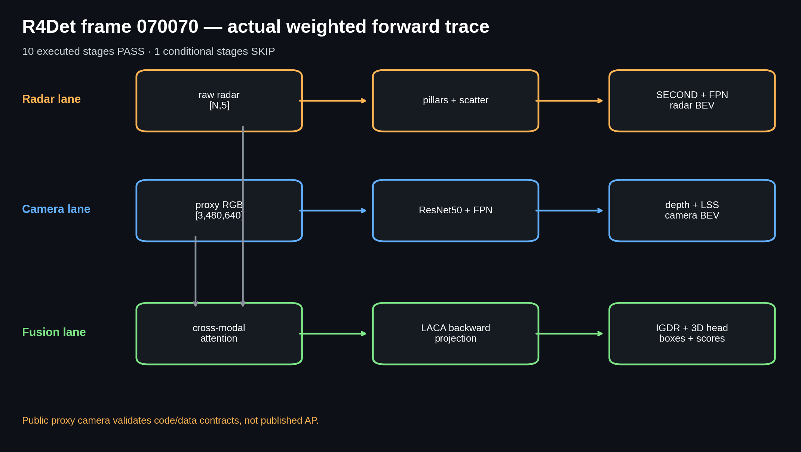
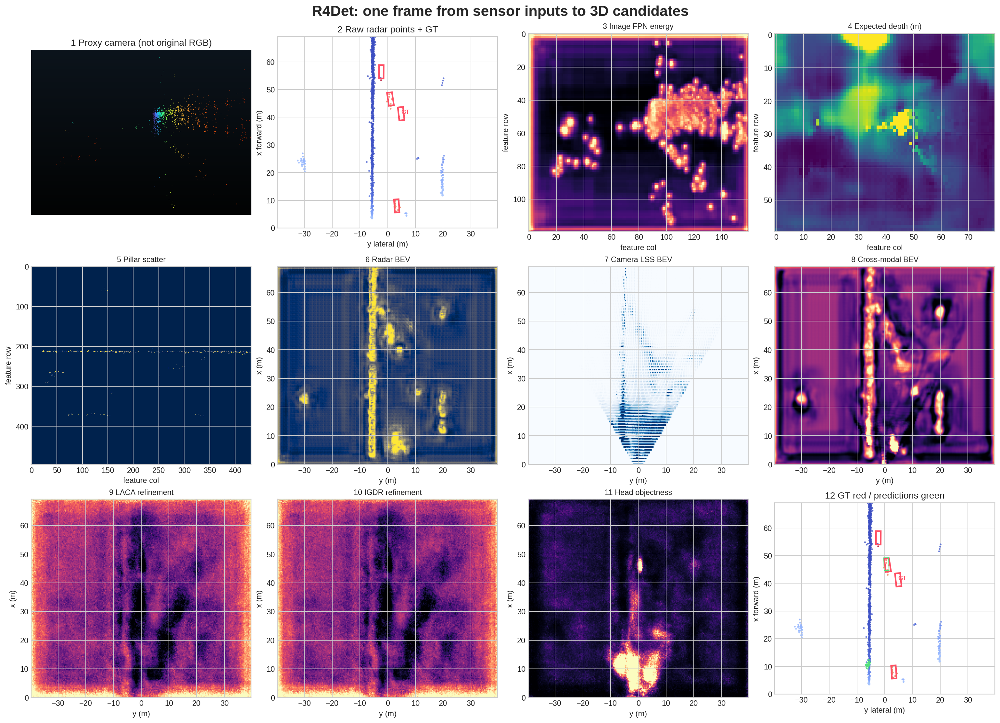
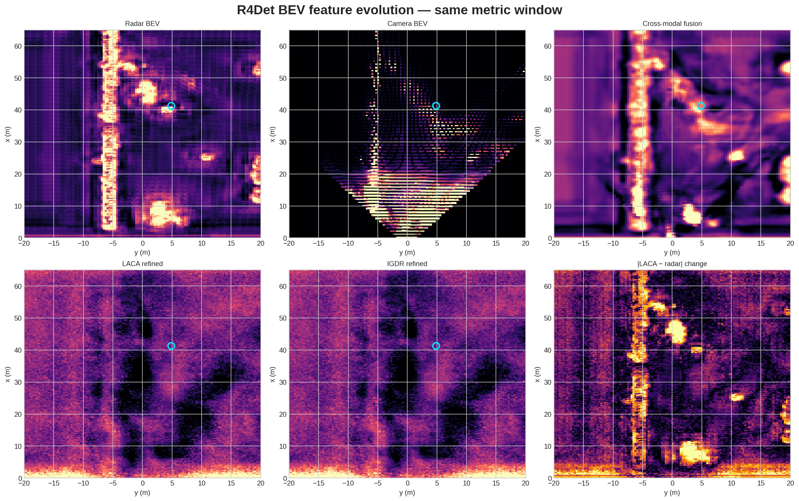

# R4Det 单帧代码学习与检验流程

[返回 R4Det 文档中心](../docs/README.md) · [本机运行手册](../docs/R4DET_RUNBOOK.md) · [自动生成状态表](STATUS.md)

## 1. 学习目标与事实边界

本流程固定追踪 TJ4D 帧 `070070`，从真实雷达点和代理相机图进入数据管线，一直走到 3D NMS 输出。每一步都回答：

```text
输入是什么 → shape/单位/坐标是什么 → 哪段代码改变它
→ 输出是什么 → 怎样证明真的运行 → 哪些结论仍不能成立
```

当前视觉输入是按标定投影真实雷达生成的代理图，不是 TJ4DRadSet 同步原始相机。图中的中间 Tensor 和完整 checkpoint 前向是真实的，但不能用来复现论文 AP，也不能证明视觉融合收益。

## 2. 一键生成图解与状态

```bash
cd /home/snailkorchagin/Radar/R4Det
./run_r4det_walkthrough.sh
```

成功标志为 `R4DET_WALKTHROUGH_OK`。输出：

- `figures/01_r4det_pipeline_overview.png`：雷达、相机、融合三泳道总览；
- `figures/02_frame_070070_process.png`：12 个真实输入、中间特征和输出阶段；
- `figures/03_bev_fusion_evolution.png`：同一 BEV 尺度下的融合过程变化；
- `figures/r4det_trace.json`：每个 hook 的输入/输出 shape、dtype、范围和 finite 状态；
- `STATUS.md`：人可读的阶段 PASS/SKIP 状态表。

图解脚本只注册 forward hook，不修改 `R4Det.py` 的计算逻辑。

### 当前实测状态

2026-09-15 本机运行结果：10 个阶段 PASS，Temporal fusion 因单帧没有有效前帧而 SKIP；IGDR 实际触发，接收 2 个实例特征；最终输出 300 个 3D candidates。逐层 shape 见 [STATUS.md](STATUS.md)。







## 3. 总数据流

```text
raw radar [N,8] ──选择 x,y,z,velocity,SNR──> [N,5]
  → voxelize → RadarPillarFeatureNet → PointPillarsScatter
  → SECOND → SECONDFPN → radar BEV [B,384,H,W]

proxy RGB → resize/normalize → ResNet50 → FPN
  + radar depth → GeometryDepth_Net
  → context + 72-bin depth distribution
  → ViewTransformerLSS → camera BEV [B,256,H,W]

radar BEV + camera BEV
  → Cross_Modal_Fusion → temporal conditional path
  → LACA backward projection → RC_BEV
  → 2D instance masks/depth → S_BEV → IGDR（条件触发）
  → Anchor3DHead → decode → rotated NMS → 300 candidates
```

BEV 物理范围为 `x=[0,69.12] m`、`y=[-39.68,39.68] m`，网格 `216×248`，分辨率 `0.32 m`。

## 4. 逐阶段代码学习路线

### L0：建立复跑锚点

阅读 `run_r4det_smoke.sh`、`tools/prepare_r4det_public_smoke.py`、`tools/r4det_smoke_test.py` 和主配置。

检验：checkpoint 严格加载；出现 `PIPELINE_OK`、`R4DET_SMOKE_OK`；manifest 必须写明 `camera_input=radar_projection_proxy_not_original_camera`。

### L1：数据管线与坐标合同

按配置的 `test_pipeline` 阅读：

```text
LoadPointsFromFile → LoadImageFromFile → loadSegmentation
→ LoadAnnotations3D → ImageAug3D2 → GlobalRotScaleTransFlipAll
→ PointsRangeFilter → Normalize → Pad
→ CreateDepthFromRaDAR → gen2DMask → CustomCollect3D2
```

输入是雷达 `[3159,8] float32`、代理图 `[960,1280,3] uint8`、标定和 4 个 GT。模型选择 `x,y,z,velocity,SNR` 五维点特征，增强后图像为 `[3,480,640]`。

检验标准：输入路径和 manifest 一致；变换矩阵 finite；点符合 `point_cloud_range`；不混用 camera/radar/BEV 坐标；代理相机身份始终保留。

### L2：雷达点到 Radar BEV

```text
R4Det.extract_pts_feat → voxelize → RadarPillarFeatureNet
→ PointPillarsScatter → SECOND → SECONDFPN
```

重点看 `mmdet3d/models/detectors/R4Det.py::extract_pts_feat` 和配置中的 `pts_*` 段。

检验标准：pillar、scatter、radar BEV hook 都 PASS；输出 finite；空间 shape 与配置一致；雷达点和能量图位于同一物理窗口。

### L3：图像骨干与 FPN

调用路径为 `extract_img_feat → ResNet50 → FPN`。

检验标准：捕获多尺度 FPN；通道为 256；空间分辨率逐级下降；明确输入采用 Caffe 风格 BGR mean，而不是 RGB/0～1 标准化。

### L4：雷达辅助深度与 LSS

```text
FPN aligned features + radar_depth + camera geometry
→ GeometryDepth_Net → context + depth [72 bins]
→ ViewTransformerLSS → camera BEV
```

重点看 `GeometryDepth_Net.py`、`ViewTransformerLSS.py` 和 `R4Det.extract_feat`。

检验标准：深度维度为 72，对应 `[1,73) m`、1 m/bin；概率 finite；期望深度图可绘制；camera BEV 与 radar BEV 覆盖同一 x/y 区间。

### L5：第一次跨模态 BEV 融合

`Cross_Modal_Fusion` 从 image/radar BEV 分别计算 avg/max attention，用另一模态的 attention 调制本模态，再拼接并降到 256 通道。

检验标准：两路输入空间 shape 相同；输出 `[B,256,216,248]` 且 finite；记录融合前后差分，不能只展示相似的彩色热图。

### L6：时序与 LACA backward projection

Temporal fusion 只在有效前帧存在时运行；没有有效前帧必须显示 `SKIP`，不能伪造 PASS。

LACA 用 BEV query、图像 FPN、深度分布和标定，再次把图像证据写回 BEV。重点看 `backward_projection/backward_projection.py` 和 DFA3D attention。

检验标准：LACA hook 必须 PASS；输出可恢复为 `[B,256,216,248]`；全部 finite；差分图证明该层改变了特征。Temporal 允许有理由的 SKIP。

### L7：2D instance 与 IGDR

RPN/RoI bbox/mask 产生 instance feature；mask 和预测深度生成 `S_BEV`，`IGDRModule` 再生成 gamma/beta 与背景 gate 修正 RC_BEV。

检验标准：有有效 2D instance 时 IGDR 必须 PASS；代理图未产生有效 instance 时允许 SKIP，但必须记录原因。SKIP 不代表模块效果已验证。

### L8：3D head、解码和 NMS

调用路径为 `Anchor3DHead → bbox coder → rotated NMS`。

检验标准：head 输出 finite；最终 300 个候选；box 至少含 `[x,y,z,dx,dy,dz,yaw]`；类别索引合法。代理图造成的低最高分不是软件失败。

## 5. 分级验收标准

### G-R4-0：环境与资产

- checkpoint、雷达、info pkl checksum 正确；
- CUDA 扩展能加载；
- checkpoint 0 missing / 0 unexpected key。

### G-R4-1：数据合同

- 能口述原始/模型输入 shape、五维点字段、图像身份和 BEV 范围；
- 能从 `(x,y)` 算出 BEV cell，并恢复米制坐标。

### G-R4-2：单帧逐层前向

- `STATUS.md` 中所有非条件阶段 PASS；
- 所有输出 finite；
- 三张图和 trace JSON 成功生成；
- 条件 SKIP 有明确原因。

### G-R4-3：实现理解

- 能分别解释 radar pillar、GDC、LSS、cross-modal fusion、LACA、IGDR；
- 能指出每个模块输入所在坐标域；
- 能预测关闭某模块后哪张中间图会变化。

### G-R4-4：消融可证伪

- 固定同一帧、权重和随机设置；
- 至少做 radar-only、camera/LSS-only、无 LACA、无 IGDR 四项；
- 比较中间特征、候选和资源，不能用代理图宣称 AP 改善。

### G-R4-5：正式性能复现

只有取得同步原始相机、官方 split 并跑完整评价协议后才允许通过。报告 AP、距离/天气分组、延迟和显存；该门禁当前明确未通过。

## 6. 推荐学习节奏

| 天 | 内容 | 当日唯一产物 |
|---:|---|---|
| 1 | L0/L1 | 手写输入、坐标和数据增强合同 |
| 2 | L2 | 雷达点→pillar→BEV shape 表和图 |
| 3 | L3/L4 | 图像 FPN、深度、LSS 对齐图 |
| 4 | L5/L6 | 融合前后与 LACA 差分图 |
| 5 | L7/L8 | instance→IGDR→box 条件路径说明 |
| 6 | 一个可逆消融 | 一张对比图和一句可证伪结论 |
| 7 | 闭卷复跑 | 不看文档定位各阶段代码和失败点 |

每次只记录运行命令、输入 checksum、关键 shape、一个图和一个“能证明/不能证明”的结论。
